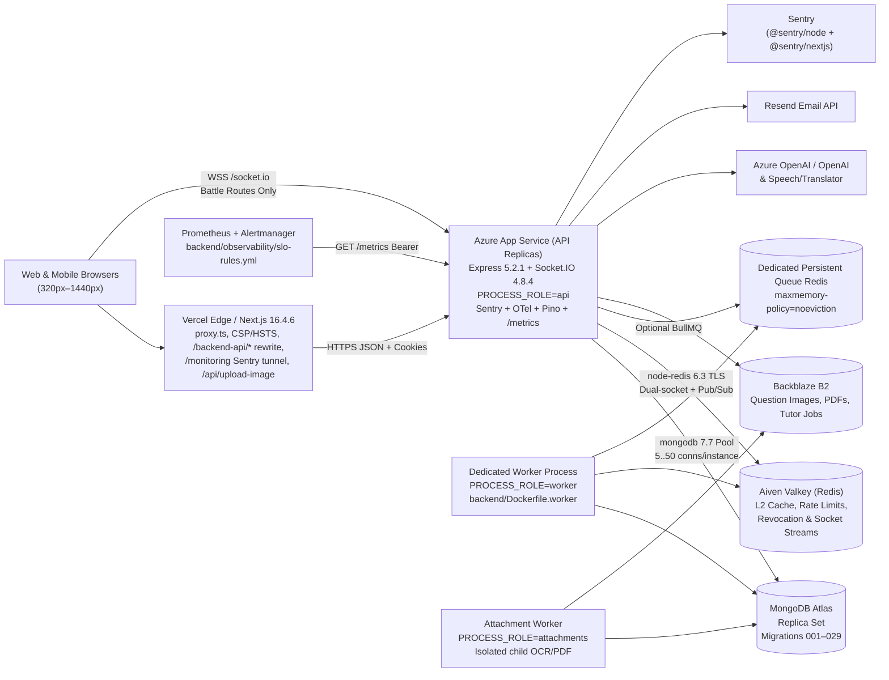

# Deliverable 01 — Architecture & Bottleneck Report

**Platform:** Meow / QuizGuru (SSC & Competitive Exam Prep Platform)  
**Target Readiness:** 1,000 concurrent active users with horizontal scaling  
**Audit Date:** 2026-11-22  
**Runtime Baseline:** Node `>=22.22.2 <23` (`v22.23.2`), Next.js `16.4.6`, React `19.3.0`, Express `5.2.1`, MongoDB Driver `7.7.0`, `redis` `6.3.0`, Socket.IO `4.8.4`

---

## 1. End-to-End Production Architecture

The repository is an npm workspaces monorepo (`package.json`) containing:
- `frontend/` — Next.js `16.4.6` / React `19.3.0` App Router deployed on **Vercel** (`@sentry/nextjs` `11.14.0`, `@vercel/speed-insights` `2.1.0`, `swr`, `axios`, `socket.io-client` `4.8.4`, `firebase`, `convex`).
- `backend/` — Express `5.2.1` + Socket.IO `4.8.4` API and background workers deployed on **Azure App Service (Linux Node 22 LTS)** (`@sentry/node` `11.16.0`, `@prometheus-io/client` `0.16.1`, `@opentelemetry/*`, `pino` `10.3.1`, `zod` `4.6.7`, `bullmq` `6.3.11`).
- `contracts/` — Shared TypeScript/Zod wire contracts (`@meow/contracts`) enforced by CI (`npm run build --workspace @meow/contracts && git diff --exit-code -- contracts/`).
- `load-tests/k6/` — Staged k6 load-testing suite (`k6 v2.4.0`).

### 1.1 System Topology

### 1.2 Backend Process Roles & Layering Boundaries

- **Process Roles (`backend/config/processRole.js`)**:
  - `PROCESS_ROLE=api` (`backend/index.js`, `npm run start:api`): Serves REST HTTP + Socket.IO; embeds maintenance/attachment workers only when `RUN_EMBEDDED_WORKERS=true`.
  - `PROCESS_ROLE=worker` (`backend/worker.js`, `npm run start:worker`, `backend/Dockerfile.worker`): Runs scheduled maintenance, battle recovery, concept grouping, question import, and scheduled notifications.
  - `PROCESS_ROLE=attachments` (`backend/attachment-worker.js`, `npm run start:attachments`): Processes durable B2-backed tutor PDF/image extraction inside isolated child processes.
- **Preload Telemetry (`backend/instrumentation.js`)**: Loaded via `node --import ./instrumentation.js ...`. Validates environment (`validateEnvironment()`), optionally starts sanitized OpenTelemetry `NodeSDK` (`OTEL_ENABLED=true`), initializes `@sentry/node` (`initSentry()`, clean no-op when `SENTRY_DSN` is unset), and chains graceful flush on `globalThis.__shutdownTelemetry`.
- **Enforced Layering (`backend/scripts/check-runtime-boundaries.js`)**: Blocks importing `config/mongodb.js` or calling `.collection(...)` from `routes/`, `controllers/`, `agents/`, and 10 specified domain services. All persistence belongs in `backend/repositories/`.

### 1.3 Caching, Auth & Realtime Architecture

- **Tiered Caching (`backend/infrastructure/tieredCache.js`, `cacheLease.js`, `cacheInvalidation.js`)**: L1 in-process `LRUCache` + L2 Valkey with `createSingleFlight` stampede coalescing, jittered TTLs, negative caching, fenced Lua leases (`acquireLease`/`writeWithLease`), and `cache-events` Pub/Sub invalidation.
- **Durable Progress Cache (`backend/infrastructure/durableProgressCache.js`)**: Combines MongoDB `runtimeCacheRevisions` with Valkey `progress-bump:v2:*`. Fails closed on MongoDB revision errors (`withCounterDeadline`, 1.5s) while coalescing L1 reads during brief Redis blips via a 1.5s local outage grace window.
- **Auth Sessions (`backend/auth/sessions.js`)**: Short-lived JWT + rotating HttpOnly `refreshToken` cookie backed by `authSessions` in MongoDB, L1 `sessionCache` (5,000 entries / 15s), Valkey `auth-session:v2:*` + revocation markers (`auth-revoked:v2:*`), and `auth-evictions` Pub/Sub.
- **Valkey Isolation (`backend/config/redis.js`)**: Dual-socket isolation (`cacheSlot` + `rateLimitSlot`) with `createRedisCircuit` circuit breaking (15s open after 5 failures/10s; 5m on quota exhaustion), 3,000ms default TLS connect timeout (`REDIS_CONNECT_TIMEOUT_MS`), and `REDIS_COMMANDS_QUEUE_MAX=4096`.
- **Battle Realtime (`backend/battle/battleSocket.js`, `redisSocketAdapter.js`)**: Authenticates JWT on handshake (`auth/socketPrincipal.js`) and revalidates every packet. Supports `@socket.io/redis-streams-adapter` (`BATTLE_REDIS_ADAPTER=true`) for horizontal multi-instance fanout and falls back to `@socket.io/mongo-adapter`.

---

## 2. Baseline Bottleneck Analysis & 1,000-VU Capacity Model

### 2.1 Measured Staging Saturation Evidence (Pre-Remediation)

Recorded baseline k6 staging run (`load-tests/k6/results-stage4-enabled.json`, `2026-11-22T07:02:32Z`) against single-instance Azure `B1` (`quizguru-stage-1177891703.azurewebsites.net`, 500 VUs, `stage4`):
- **Total Requests:** `4,803` (`13.32 req/s`)
- **HTTP Failure Rate:** `43.60%` (`966` failed answer submissions, `0` completed journeys)
- **Tail Latency:** `sessionCreate` p95 = `59,828.58 ms`, `answerSubmit` p95 = `59,996.83 ms`

**Root causes identified across the stack:**
1. Single-vCPU `B1` (`1.75 GiB` RAM) running API + 12 embedded workers (`RUN_EMBEDDED_WORKERS=true`).
2. `QUESTIONS_NORMALIZED_KEYS` defaulted to `false` on legacy/cursor/meta paths and was unset in staging, triggering regex scans and `$or` `{ <field>Key: { $exists: false } }` index-defeating branches.
3. Auth cold/degraded fallback executed 4 MongoDB reads per request (`authorizationState` called twice) and fast path executed 3 sequential-style Valkey round trips instead of 1 `mGet`.
4. `bcryptjs` cost-12 password hashing ran on the main Node.js event loop (~250–400ms CPU per login).
5. Uncached `startMockTest` full-paper reads, uncached `computePercentile` `countDocuments` scans, uncached battle leaderboards, and uncached `/health` Mongo queries amplified DB load.
6. Frontend fired pre-hydration `POST /auth/refresh` on every page load including guests, mounted protected child effects while `AuthGate` was still loading, and lacked double-submit locks on Battle Rewards and AI Chat.

### 2.2 Infrastructure Sizing Target for 1,000 Concurrent Active Users

| Layer | Pre-Remediation Staging/Prod | Recommended 1,000-VU Production Target | Budgeting Rule |
|---|---|---|---|
| **Azure App Service (API)** | 1x `B1` (1 vCPU, 1.75 GiB) + embedded workers | **2–3x `P1v3`** (2 vCPU, 8 GiB each) or **2x `P2v3`**, Always On, ARR Affinity Off (with `BATTLE_REDIS_ADAPTER=true`) | Keep peak CPU < 60%, RSS < 1.2 GiB/instance, event-loop p99 < 100ms |
| **Background Workers** | Embedded inside API (`RUN_EMBEDDED_WORKERS=true`) | Dedicated `worker.js` (`PROCESS_ROLE=worker`) + `attachment-worker.js` (`PROCESS_ROLE=attachments`) via `Dockerfile.worker`; set `RUN_EMBEDDED_WORKERS=false` on API | Eliminates worker CPU/GC jitter on API event loop |
| **MongoDB Atlas** | Shared/single-node dev or low tier | **Dedicated `M10`–`M30`** (auto-scaling storage + PITR enabled) | `(API_instances × MONGO_MAX_POOL_SIZE) + worker_pools < 80% Atlas maxConnections` (e.g., `3 × 40 + 20 = 140` conns) |
| **Aiven Valkey (Cache)** | Single cache endpoint, 1s connect timeout | TLS `rediss://` plan sized for **≥ 500 conns** (`5–7` conns/instance), `allkeys-lru` for cache | Keep `QUEUE_REDIS_URL` on a **separate** persistent `noeviction` instance if `USE_DURABLE_QUEUE=true` |
| **Vercel Frontend** | Dynamic SSR on `/` + guest refresh storms | Edge-cached static/ISR shells + gated `early-session.ts` + zero idle Socket.IO | Keeps `/auth/refresh` proportional strictly to returning authenticated users |

> **Honesty Caveat on Capacity Claims:** Local Windows verification (`node v22.23.2`, `k6 v2.4.0`, offline `MongoMemoryReplSet`, no local `docker`/`valkey-server`) validates code correctness, `22/22` `IXSCAN` query plans, and single-host regressions, but **cannot prove cloud 1,000-VU multi-instance capacity**. Sustained 1,000-VU readiness must be certified on scaled isolated staging with real Aiven Valkey + Atlas + multi-instance App Service.

---

## 3. Prioritized Findings & Remediation Tracker

### Critical Findings

| ID | Finding & Root Cause | Exact Files & Symbols | Remediation Status |
|---|---|---|---|
| **CRIT-1** | **Multi-Instance Battle & Maintenance Worker Contention**: Embedded workers ran un-locked on every API replica; `battleQuestionDeadlineWorker` (`.limit(50)`) and `battlePresenceWorker` (`.limit(20)`) capped throughput and lacked distributed locks; `battlePresenceWorker` emitted `game:end` to stale `socketId` without `rating`/`matchStats`. | `backend/services/battleQuestionDeadlineWorker.js`, `battlePresenceWorker.js`, `battleResultWorker.js`, `.github/workflows/main_quizguru-backend.yml` | **Fixed in Code (M2 & M4)**: Added Redis `SET NX PX` + Mongo `battleMatchmakingLocks` distributed leases, looped multi-batch draining (up to 500 rooms/tick), unified `game:end` emission to `user:${userId}` with full `rating`/`matchStats`, and made `RUN_EMBEDDED_WORKERS`/`BATTLE_REDIS_ADAPTER` configurable via workflow vars. *(Ops: flip vars to decoupled worker topology when scaling >1 API replica.)* |
| **CRIT-2** | **Auth Cold/Degraded Fallback 4x Mongo Reads & 3x Redis RTT**: `readAuthorizationPayload` made 3 separate `redisGetJson` calls on fast path and unconditionally called `authorizationState(decoded)` twice (4 Mongo reads) on fallback. | `backend/auth/sessions.js` (`readAuthorizationPayload`) | **Fixed (M1)**: Batched fast-path lookups into 1 `redisGetJsonMany` (`mGet`) call; halved fallback path to 1 `authorizationState` call (2 Mongo reads) while preserving zero-window privileged-role checks and all revocation fences. |
| **CRIT-3** | **`QUESTIONS_NORMALIZED_KEYS` Defaulted `false` & `$or` Fallback Branches Defeated `IXSCAN`**: Legacy/meta/cursor paths fell back to `$regex`, staging left flag unset, and `quizSessionV1Service`/`mockPaperService` emitted `{ <field>Key: { $exists: false } }` `$or` clauses. | `backend/services/questions/questionCache.js` (`isNormalizedQuestionKeysEnabled`), `questionCursorService.js`, `quizSessionV1Service.js`, `mockPaperService.js`, `.github/workflows/main_quizguru-backend-staging.yml` | **Fixed (M2 & M4)**: Unified default to `true`, switched cursor queries to normalized keys + `maxTimeMS(5000)`, gated `$or` fallback behind `QUESTIONS_ALLOW_UNNORMALIZED_FALLBACK === 'true'`, enabled `QUESTIONS_NORMALIZED_KEYS=true` in staging/prod workflows, and proved `22/22` `IXSCAN` via `audit-db-explain.js`. |
| **CRIT-4** | **Missing HTTP Request Timeouts / Abort Propagation & Premature Idempotency Lock Deletion**: `httpListen.js` left Node's 5m default `requestTimeout`; `idempotency.js` deleted `pending` keys on `res.on('close')` allowing duplicate writes on client disconnect; `quizSessionRoutes.js` ran `idempotency` before `validateBody`. | `backend/middleware/idempotency.js`, `backend/middleware/requestTimeout.js`, `backend/infrastructure/httpListen.js`, `backend/app.js`, `backend/routes/v1/quizSessionRoutes.js` | **Fixed (M1)**: Removed `res.on('close')` pending lock deletion, made `400` retryable, moved `validateBody` before `idempotency`, set `server.requestTimeout = 60000`, and added `requestTimeout()` `AbortController` middleware (30s std / 60s AI & uploads -> `504 REQUEST_TIMEOUT`, safe on Node 22). |
| **CRIT-5** | **`/battle/rewards` Missing Auth Guard, Error UI & Double-Claim Lock**: Fired unauthenticated fetch on mount with no `.catch()` or `AbortController` and allowed rapid double-click claims without `Idempotency-Key`. | `frontend/app/(app)/battle/rewards/page.tsx`, `frontend/lib/api/battleRewardApi.ts` | **Fixed (M3)**: Gated on `useAuth()` readiness, added `AbortController`, explicit `role="alert"` error + retry UI, synchronous `claimingRef` + `claimingLevel` lock, `Idempotency-Key`, and Vitest regression tests. |
| **CRIT-6** | **Pre-Hydration Guest `POST /auth/refresh` Storm**: `earlySessionScript` fired `POST /auth/refresh` unconditionally on every page load including unauthenticated guests and auth routes. | `frontend/lib/early-session.ts`, `frontend/lib/axios.ts` | **Fixed (M3)**: Added non-sensitive `meow_has_session` hint synced on token updates/401s and skipped `/auth/refresh` for guests and auth routes (`/login`, `/register`, `/access-code`, `/reset-password`, `/verify-email`, `/check-email`). |

### High Findings

| ID | Finding & Root Cause | Exact Files & Symbols | Remediation Status |
|---|---|---|---|
| **HIGH-1** | **`bcryptjs` Cost-12 Blocked Event Loop**: Synchronous/main-thread cost-12 hashing starved Node's event loop under concurrent logins. | `backend/auth/passwordHash.js`, `passwordWorker.js`, `passport.js`, `routes/auth.routes.js` | **Fixed (M1)**: Offloaded `hashPassword`/`verifyPassword` to a bounded `worker_threads` pool (max 4 `.unref()`ed workers) with lazy `getDummyPasswordHash()`. |
| **HIGH-2** | **Auth Abuse Gaps**: No per-account login lockout on `/auth/login`, no per-email cooldown/hourly cap on `/forgot-password` & `/resend-verification`, unguarded `/auth/google/callback` `createSession`, inconsistent `isProd` cookie checks. | `backend/repositories/authLoginLockoutRepository.js`, `backend/routes/auth.routes.js`, `backend/auth/requestOrigin.js`, `oauthState.js` | **Fixed (M1)**: Added 5-strike/15m per-account lockout (`429 ACCOUNT_LOCKED`), 60s cooldown + 5/hr recovery quota (uniform `200`), OAuth callback `try/catch` redirect, and unified `isProductionCookieEnv()`. |
| **HIGH-3** | **`questionRoutes.js` Catch-All Error Handler Swallowed 5xx as 400**: Raw internal error messages leaked in production and bypassed centralized `errorHandler`. | `backend/routes/questionRoutes.js` | **Fixed (M1)**: Scoped Multer error handling strictly to `questionUpload` and forwarded all other errors via `next(err)`. |
| **HIGH-4** | **Uncached `/health` Mongo Queries**: Every health probe executed live Mongo `ping` + `schemaMigrations` query unthrottled. | `backend/infrastructure/readiness.js`, `backend/app.js` | **Fixed (M1)**: Added single-flight coalesced `checkReadiness()` cache (3s `READINESS_CACHE_TTL_MS`) and 60s `assertMigrations` cache with `force: true` bypass. |
| **HIGH-5** | **Uncached `startMockTest` Paper Reads, Mock Percentiles & Battle Leaderboards**: Hot endpoints hit MongoDB directly on every request; battle leaderboard indexes placed `gamesPlayed` trailing. | `backend/controllers/mockTestController.js`, `services/mock/mockGradingService.js`, `controllers/battleController.js`, `repositories/battleRepository.js`, `migrations/029-production-scale-indexes.js` | **Fixed (M2)**: Switched `startMockTest` to `fetchCachedSlotById`, cached percentile counts (45s/60s + `maxTimeMS(2000)`), cached global & seasonal battle leaderboards (30s + singleflight + projections + `maxTimeMS(3000)`), and added partial indexes in migration `029`. |
| **HIGH-6** | **Non-Atomic Bookmarks & Missing Progress/Usage Idempotency**: `updateBookmarks` did 2 separate writes; `/users/me/progress` and `/users/me/usage` lacked idempotency. | `backend/repositories/userRepository.js` (`mutateUserBookmarks`), `controllers/userController.js`, `routes/user.routes.js` | **Fixed (M1)**: Atomic `mutateUserBookmarks` CAS/tx update and optional `idempotency` middleware on `PATCH /users/me/progress` & `PATCH /users/me/usage`. |
| **HIGH-7** | **Zero Backend Sentry & Incomplete Prometheus Saturation Alerts**: Backend had no `@sentry/node` SDK; `slo-rules.yml` lacked latency, Mongo pool, Valkey circuit, RSS, heap growth, and event-loop lag alerts. | `backend/package.json`, `backend/infrastructure/sentry.js`, `backend/instrumentation.js`, `backend/middleware/errorHandler.js`, `backend/app.js`, `backend/observability/slo-rules.yml` | **Fixed (M4)**: Installed `@sentry/node@^11.16.0`, added PII-scrubbing `sentry.js` + Express/errorHandler hooks, and added 3 recording rules + 9 actionable saturation/latency alerts to `slo-rules.yml`. |
| **HIGH-8** | **Unmounted `NotificationCenterProvider`, Eager Socket Fanout & `/notifications` Auto-Read**: Notification badge was dead; mounting as written would open 1,000 idle sockets; visiting `/notifications` wiped unread counts on mount. | `frontend/app/(app)/layout.tsx`, `frontend/context/NotificationCenterContext.tsx`, `frontend/app/(app)/notifications/page.tsx` | **Fixed (M3)**: Replaced eager `getSocket()` with visibility-aware 60–120s REST polling, mounted `NotificationCenterProvider` in `StudyLayout`, removed auto-mark-all-read on mount, and added `markingAllRef` lock. |
| **HIGH-9** | **AI Chat & `QuizChatbot` Double-Submit Race & Missing Text `Idempotency-Key`**: State-only `isLoading` check allowed rapid double submissions and lacked `AbortController`. | `frontend/app/(app)/ai-chat/page.tsx`, `frontend/components/QuizChatbot/index.tsx`, `frontend/features/tutor/api/tutorGateway.ts` | **Fixed (M3)**: Added synchronous `sendingRef` lock, `AbortController` on unmount/"New chat", and `Idempotency-Key` on text `/api/ai/tutor-chat`. |
| **HIGH-10** | **`AuthGate` Mounted Protected Children During Auth Hydration**: Non-SWR `useEffect` hooks fired unauthenticated `401` API calls while `loading === true`. | `frontend/components/auth/AuthGate.tsx` | **Fixed (M3)**: Renders accessible loading shell (`role="status"`, `aria-busy="true"`) when `!isPublic && loading`. |
| **HIGH-11** | **Frontend Security Headers, Duplicate Report-Only CSP & Unbounded `/api/upload-image`**: Redundant CSP-Report-Only header, missing HSTS/X-Frame-Options/Permissions-Policy, unused CDN origins, unbounded proxy upload, `NEXT_PUBLIC_ADMIN_SECRET` risk. | `frontend/next.config.ts`, `frontend/lib/security/csp.ts`, `frontend/app/api/upload-image/route.ts` | **Fixed (M3)**: Removed duplicate report-only CSP, added HSTS/X-Frame-Options/Permissions-Policy, pruned unused CDNs, enforced 10 MB `413` limit + signal/requestId forwarding + safe non-JSON handling in `/api/upload-image`, added production build guard for `NEXT_PUBLIC_ADMIN_SECRET`. |

### Medium Findings

| ID | Finding & Root Cause | Exact Files & Symbols | Remediation Status |
|---|---|---|---|
| **MED-1** | **AI Tutor Prompt Injection Delimiters, Sync AI Idempotency & Missing `aiAdmission` on Diagnosis** | `backend/services/tutorChatService.js`, `backend/routes/aiRoutes.js`, `backend/routes/training.js` | **Fixed (M1)**: Added `<student_context>`/`<student_question>` delimiters & system hierarchy, added `idempotency` on `/diagram`, `/explain`, and JSON `/tutor-chat`, and added `aiAdmission` on `/diagnosis`. |
| **MED-2** | **Incomplete Zod Coverage & `.passthrough()` Mass-Assignment Surfaces** | `backend/routes/mocktest.js`, `notes.routes.js`, `training.js`, `questionRoutes.js`, `user.routes.js`, `controllers/imageQuestionController.js` | **Fixed (M1)**: Stripped `.passthrough()` in `mocktest.js`, added Zod schemas on `notes.routes.js`, `training.js`, `questionRoutes.js`, and `PUT /users/me/ai-chats/:chatId`, and wrapped `JSON.parse(optionRegions)` in `try/catch` (`400`). |
| **MED-3** | **Socket.IO CORS Dropped `CORS_ALLOWED_ORIGINS`, Unbounded Question Export & Unindexed Admin Search** | `backend/battle/battleSocket.js`, `controllers/questionController.js`, `services/questions/questionReadService.js`, `controllers/adminUsers.controller.js`, `repositories/adminUserRepository.js` | **Fixed (M2)**: Added `buildSocketCorsOrigins`, streamed NDJSON via `iterateExportCursor`, switched admin user search to `$text`/anchored prefix + `maxTimeMS(3000)` and bounded covered `pushDevices` lookup. |
| **MED-4** | **Valkey TLS Connect Timeout (1s) & `durableProgressCache` Outage Amplification** | `backend/config/redis.js`, `backend/battle/redisSocketAdapter.js`, `backend/infrastructure/durableProgressCache.js` | **Fixed (M2)**: Raised default `REDIS_CONNECT_TIMEOUT_MS` to `3000` and `REDIS_COMMANDS_QUEUE_MAX` to `4096`; added 1.5s Redis-outage L1 grace window + fail-closed `withCounterDeadline(1500ms)`. |
| **MED-5** | **Frontend Mobile/Bundle Overhead, Missing Route Error Boundaries & Secondary Action Races** | `frontend/components/ai/VisualResponse.tsx`, `HomeStaticContent.tsx`, `app/layout.tsx`, `resource/page.tsx`, `hooks/useBattle.ts`, `app/(app)/*/error.tsx`, `app/(admin)/error.tsx` | **Fixed (M3)**: Memoized `extractVisuals` + replaced per-cell `ReactMarkdown` with `MathText`, lazy-loaded dark hero backdrop, deduplicated Bengali font weights (`400`/`700`), added `AbortController` + per-file lock on `/resource`, preferred `battle:resume` before socket reconnect in `useBattle`, and added 7 segment `error.tsx` boundaries. |

### Low Findings

| ID | Finding & Root Cause | Exact Files & Symbols | Remediation Status |
|---|---|---|---|
| **LOW-1** | **Hardcoded Quiz Cursor Secret Fallback (`'meow-quiz-session-cursor-v1'`)** | `backend/services/questions/quizSessionV1Service.js` (`getCursorSecret`) | **Fixed (M2)**: Production now requires `QUIZ_CURSOR_SECRET || JWT_SECRET`; non-prod generates ephemeral 32-byte random secret. |
| **LOW-2** | **Admin Battle Integrity Missing Action Busy State & Pagination** | `frontend/app/(admin)/admin/battle-integrity/page.tsx` | **Fixed (M3)**: Added per-event `busyIds`/`busyRef` lock and "Load more" control using `hasMore`. |
| **LOW-3** | **Legacy Local `/uploads` Static Mount & Missing API Dockerfile** | `backend/app.js:93`, `backend/Dockerfile.worker` | **Tracked Operational Follow-up**: Complete `npm run db:migrate-images -- --apply` to B2 before removing `/uploads`; API deploys cleanly via Azure OneDeploy tarball (`release.tar.gz`). |
| **LOW-4** | **`frontend/proxy.ts` Fails Closed When Access Secrets Unset** | `frontend/proxy.ts`, `frontend/.env.example` | **Documented (M4)**: Documented server-only `SESSION_SECRET`, `ACCESS_CODE_SECRET`, and `ADMIN_SECRET` in `frontend/.env.example` and Deliverable 04. |
